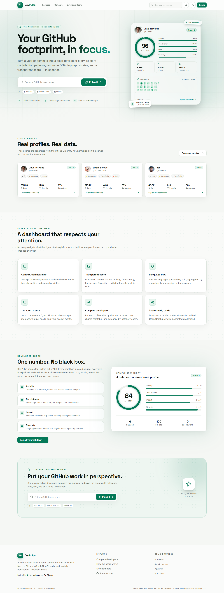
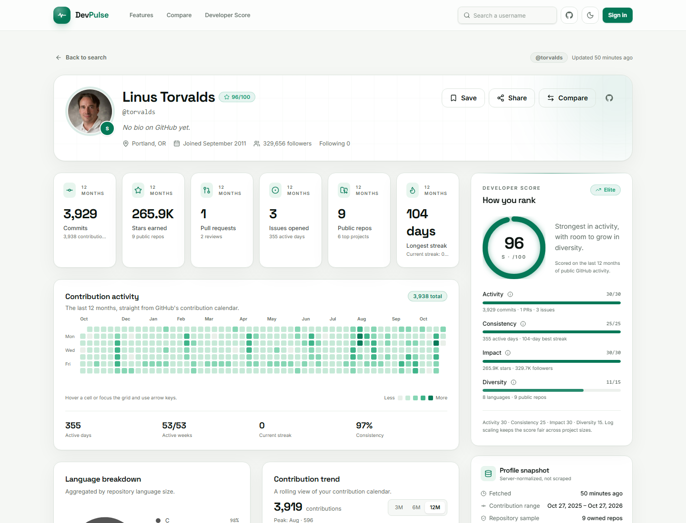
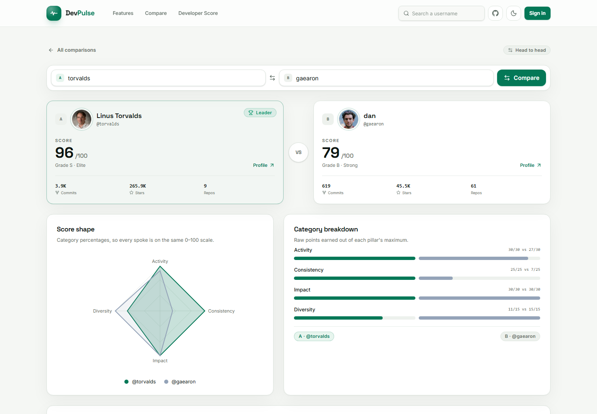
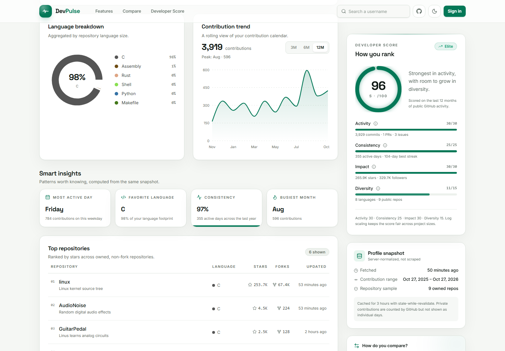
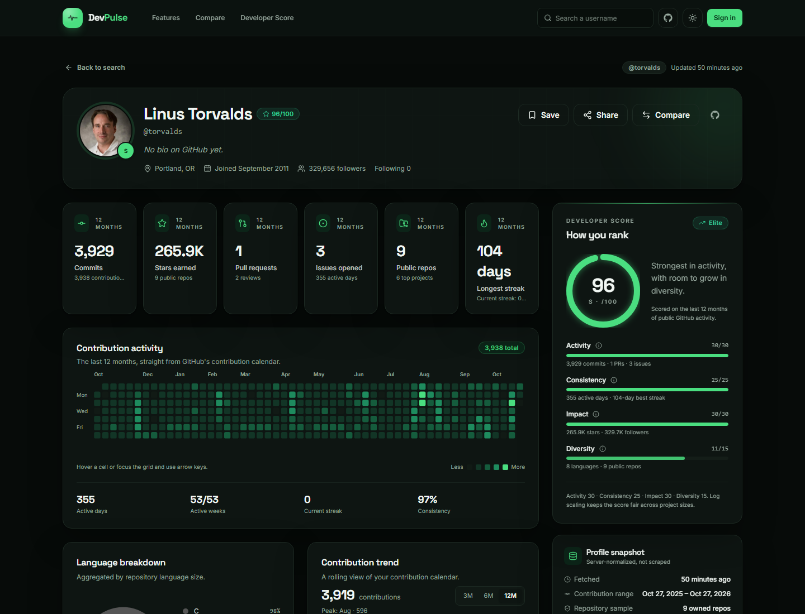
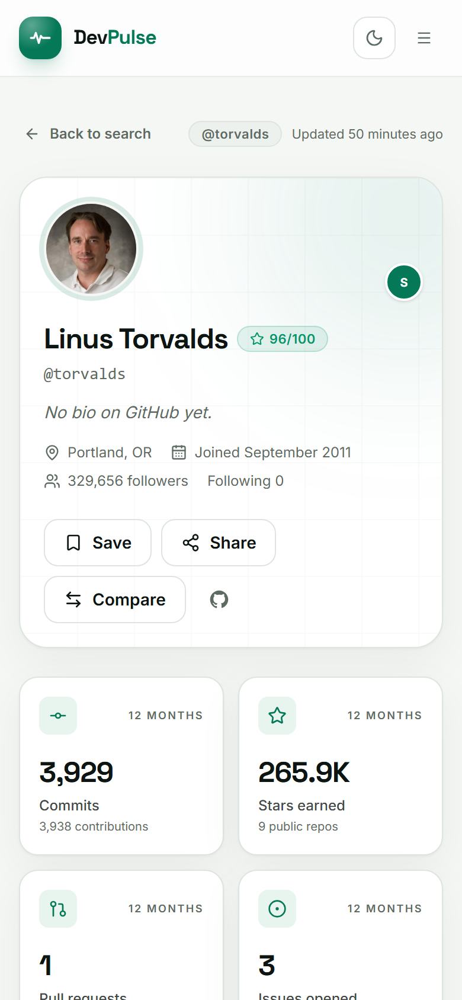
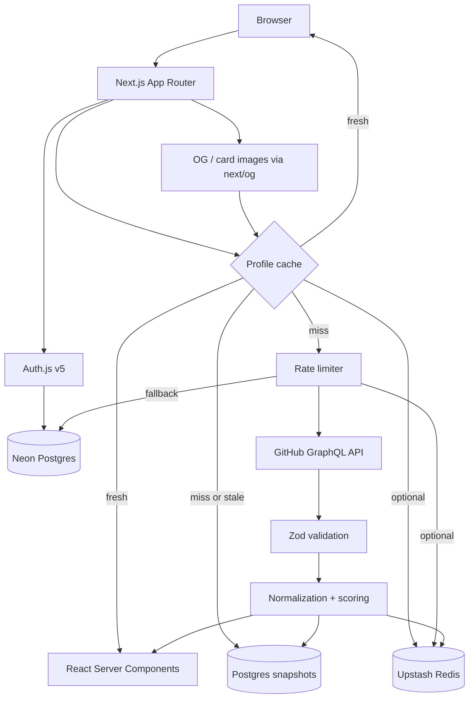

# DevPulse

**Your GitHub footprint, in focus.**

DevPulse is a polished GitHub analytics dashboard that turns a year of public
activity into a clear developer story: contribution patterns, language DNA,
top repositories, 3/6/12-month trends, and a transparent 0–100 Developer Score.

Built as a free, production-ready portfolio project with Next.js 16, Prisma,
Neon Postgres, Auth.js, and the GitHub GraphQL API.

[](https://github.com/zee5256/devpulse/actions/workflows/ci.yml)



- **Live app:** https://devpulse-rouge.vercel.app
- **Repository:** https://github.com/zee5256/devpulse
- **Demo profiles:** [/u/torvalds](https://devpulse-rouge.vercel.app/u/torvalds), [/u/sindresorhus](https://devpulse-rouge.vercel.app/u/sindresorhus), [/u/gaearon](https://devpulse-rouge.vercel.app/u/gaearon), [/u/cassidoo](https://devpulse-rouge.vercel.app/u/cassidoo)

---

## Overview

Most GitHub profile tools are either a wall of counters or a black-box score.
DevPulse focuses on the questions that actually matter:

- **What does this developer’s year look like?** A custom SVG contribution
  heatmap with keyboard navigation and day-level tooltips.
- **Where does their impact land?** Stars, followers, pull requests, issues, and
  top repositories, normalized on the server.
- **Are they consistent?** Active days, current streak, longest streak, active
  weeks, and a consistency percentage.
- **What is the shape of their skill set?** Language breakdown aggregated by
  repository language size, plus a diversity signal.
- **How do two developers compare?** A side-by-side stat table and a radar chart
  built on the same category percentages.

Everything public works without an account. GitHub OAuth is optional and only
unlocks favorites and the personal dashboard.

---

## Features

### Public analytics

- **Developer search** with Zod-validated, sanitized GitHub usernames.
- **Profile dashboard** at `/u/[username]`:
  - Profile header with avatar, bio, location, join date, and follower counts.
  - Six animated stat cards: commits, stars, pull requests, issues, public
    repositories, and longest streak.
  - Custom SVG contribution heatmap with month labels, weekday labels, legend,
    hover tooltips, and arrow-key navigation.
  - Language donut chart with repository-size-based percentages.
  - 3/6/12-month contribution trend chart.
  - Smart insights: most active weekday, favorite language, consistency, and
    busiest month.
  - Top repositories ranked by stars, with language, stars, forks, and recency.
- **Compare mode** at `/compare` and `/compare/[a]/[b]`:
  - Side-by-side score cards and a winner indicator.
  - Radar chart comparing category percentages on the same 0–100 scale.
  - Raw category breakdown and a per-metric comparison table.
- **Shareable profile cards**:
  - Dynamic Open Graph image per profile.
  - Downloadable 1200×630 PNG at `/api/card/[username]`.
  - Copy-link and share-on-X actions.
- **Dark and light mode**, responsive layouts, and reduced-motion support.
- **Friendly error states** for invalid usernames, GitHub rate limits, missing
  tokens, network failures, and unknown users.
- **SEO**: per-profile metadata, canonical URLs, sitemap, robots, and OG images.

### Signed-in experience (optional)

- GitHub OAuth through Auth.js / NextAuth v5 with a Prisma adapter.
- Database-backed sessions.
- Save/remove favorites from any profile.
- Personal dashboard at `/dashboard`, sorted by Developer Score.
- Favorites API with Zod validation and authenticated access checks.

### Reliability

- **3-hour profile cache** with **stale-while-revalidate**:
  - Fresh snapshots are served from Upstash Redis when configured.
  - Neon Postgres is always the durable fallback.
  - Stale snapshots render immediately while a background refresh updates both
    cache layers.
  - If GitHub is temporarily unavailable, stale data still renders with a clear
    notice.
- **Per-IP rate limiting** on live GitHub fetches:
  - Upstash sliding window when configured.
  - Atomic Postgres `INSERT … ON CONFLICT` fallback otherwise.
  - Cached reads do not consume the GitHub API budget.
- **Server-only GitHub token.** The token is never exposed to the client and is
  never prefixed with `NEXT_PUBLIC_`.
- **Typed GitHub data layer** with Zod response validation and normalized
  domain models.
- **Deduplicated profile fetches** between `generateMetadata` and page render
  using React `cache`.

---

## Screenshots

| Profile dashboard | Compare mode |
| --- | --- |
|  |  |

| Language, trends, and repositories | Dark mode |
| --- | --- |
|  |  |

<p align="center">
  
</p>

---

## Developer Score

The score is deliberately simple, documented, and reproducible. Every category
is shown on the dashboard with its points, maximum, and a plain-English
explanation.

| Pillar | Max | Signals |
| --- | ---: | --- |
| Activity | 30 | Commits, pull requests, issues, and reviews over the last 12 months. Log-scaled. |
| Consistency | 25 | Active-day ratio (15 pts) + longest streak, capped at 60 days (10 pts). |
| Impact | 30 | Stars (20 pts) + followers (10 pts), both log-scaled. |
| Diversity | 15 | Language breadth (9 pts) + public repository count (6 pts). |

```text
total = activity + consistency + impact + diversity   // 0–100

Activity    = round(30 × log10(1 + signals) / log10(1 + 2500))
signals     = commits + 2×PRs + 1.5×issues + 0.5×reviews

Consistency = round(15 × activeDays/365 + 10 × min(longestStreak/60, 1))

Impact      = round(20 × log10(1+stars)/log10(1+50000)
                  + 10 × log10(1+followers)/log10(1+25000))

Diversity   = round(9 × min(languages/6, 1) + 6 × min(publicRepos/25, 1))
```

Grades: **S** ≥ 90, **A** ≥ 80, **B** ≥ 70, **C** ≥ 60, **D** ≥ 50, **E** below 50.

Log scaling keeps the score useful for contributors at every scale: a prolific
maintainer can still max a category, but a smaller profile is not flattened to
zero next to them.

---

## Architecture



### Request lifecycle

1. The route validates the username with Zod and normalizes it to lower case.
2. `getProfile` checks Upstash (if configured), then Postgres.
3. Fresh data returns immediately. Cached reads do not touch GitHub.
4. Stale data returns immediately and schedules a background refresh.
5. On a cache miss, the per-IP limiter is checked, then GitHub GraphQL is called
   with a server-only token.
6. The response is validated with Zod, normalized into dashboard-ready data,
   scored, and written back to Postgres (and Redis when available).
7. `generateMetadata` and the page share one fetch through React `cache`.

---

## Stack

| Layer | Technology |
| --- | --- |
| Framework | Next.js 16 (App Router, Turbopack/Webpack fallback) |
| Language | TypeScript |
| UI | Tailwind CSS v4, shadcn-style Radix primitives, Lucide icons |
| Motion | Framer Motion |
| Charts | Recharts + a custom SVG contribution heatmap |
| Database | Neon Postgres + Prisma 6 |
| Auth | Auth.js / NextAuth v5 + `@auth/prisma-adapter` |
| GitHub data | GitHub GraphQL API |
| Validation | Zod 4 |
| Cache | Upstash Redis (optional) + Postgres fallback |
| Images | `next/og` (built on `@vercel/og`) |
| Tests | Vitest |
| CI | GitHub Actions |
| Hosting | Vercel Hobby |

All services used are free-tier friendly. Upstash and GitHub OAuth are optional;
the app runs with only Neon + a GitHub token.

---

## Getting started

### Prerequisites

- Node.js 20.9+ (Node 24 recommended)
- A free [Neon](https://neon.tech) Postgres database
- A GitHub token with public read access
- Optional: a GitHub OAuth app for sign-in/favorites
- Optional: an Upstash Redis database for the distributed cache layer

### 1. Install

```bash
git clone https://github.com/zee5256/devpulse.git
cd devpulse
npm install
```

`postinstall` runs `prisma generate`.

### 2. Configure environment

Copy `.env.example` to `.env` and fill in the values:

```bash
cp .env.example .env
```

Generate an auth secret:

```bash
openssl rand -base64 32
```

### 3. Set up the database

```bash
npx prisma migrate dev --name init
npm run db:seed
```

The seed prewarms `torvalds`, `sindresorhus`, `gaearon`, and `cassidoo` so the
landing page has live examples immediately.

### 4. Run

```bash
npm run dev
```

Open [http://localhost:3000](http://localhost:3000).

> This project uses `next dev --webpack` / `next build --webpack` for portability
> on machines where the native SWC/Turbopack binary is restricted.

---

## Environment variables

| Variable | Required | Purpose |
| --- | --- | --- |
| `DATABASE_URL` | Yes | Pooled Neon/Postgres connection used by the app. |
| `DIRECT_URL` | Yes | Direct Neon connection used by Prisma migrations. |
| `AUTH_SECRET` | Yes | Auth.js session encryption secret. |
| `AUTH_URL` | Local only | Base URL for Auth.js in local development. |
| `AUTH_GITHUB_ID` | Optional | GitHub OAuth app client ID. |
| `AUTH_GITHUB_SECRET` | Optional | GitHub OAuth app client secret. |
| `GITHUB_TOKEN` | Yes | Server-only GitHub GraphQL token. A fine-grained read-only PAT is recommended. |
| `NEXT_PUBLIC_SITE_URL` | Yes | Canonical site URL used by metadata, sitemap, and share links. |
| `UPSTASH_REDIS_REST_URL` | Optional | Enables the Redis cache and distributed rate limiter. |
| `UPSTASH_REDIS_REST_TOKEN` | Optional | Upstash token. |

### GitHub token

For local development, a classic token with public read access is enough. For
production, use a fine-grained token with read-only public repository access and
store it only in the Vercel environment. Never commit `.env` and never expose the
token with a `NEXT_PUBLIC_` prefix.

### GitHub OAuth (optional)

1. Create an OAuth app at
   [github.com/settings/developers](https://github.com/settings/developers).
2. Set the callback URL to
   `https://YOUR_DOMAIN/api/auth/callback/github`
   (and `http://localhost:3000/api/auth/callback/github` for local development).
3. Add `AUTH_GITHUB_ID` and `AUTH_GITHUB_SECRET`.
4. Restart the app.

Without OAuth credentials, the public analytics still work. The login page shows
setup instructions and the header hides the signed-in state.

---

## Deployment

### Vercel + Neon

1. Push the repository to GitHub.
2. Import the repo into Vercel.
3. Add the environment variables above to Production and Preview.
4. Set `NEXT_PUBLIC_SITE_URL` to the production URL.
5. Deploy. `vercel-build` runs `prisma migrate deploy && next build --webpack`.
6. Add the production GitHub OAuth callback URL if using sign-in.
7. Optionally add Upstash credentials; no code changes are needed.

The Hobby plan is enough for this project. Cached reads keep GitHub API usage
low, and the rate limiter prevents a single IP from exhausting the token.

### Database migrations

```bash
npm run db:migrate   # local development
npm run db:deploy    # production (also runs in vercel-build)
```

---

## Testing and quality

```bash
npm run lint       # ESLint (Next.js core-web-vitals + TypeScript)
npm run typecheck  # next typegen && tsc --noEmit
npm run test       # Vitest unit tests
npm run build      # production build
```

Unit tests cover:

- Score caps, grade thresholds, transparency fields, and log-scaled behavior.
- Streak detection, monthly series construction, language aggregation,
  weekday insights, and full GraphQL normalization.

CI (`.github/workflows/ci.yml`) runs lint, type-check, tests, migrations, and a
production build against a temporary Postgres service.

---

## Project structure

```text
app/
  api/
    auth/[...nextauth]/route.ts   Auth.js handlers
    card/[username]/route.ts      Downloadable profile card
    favorites/                    Authenticated favorites API
  compare/                        Compare landing + detail routes
  dashboard/                      Signed-in watchlist
  login/                          OAuth sign-in + setup guidance
  u/[username]/                   Profile dashboard + OG image
  layout.tsx, page.tsx, globals.css
components/
  auth/                           Login form
  compare/                        Compare form, radar, comparison tables
  landing/                        Hero search, preview, demo cards
  layout/                         Header, footer
  profile/                        Heatmap, charts, score, stats, repos
  share/                          ImageResponse card composition
  ui/                             Design-system primitives
lib/
  cache/profile.ts                3h cache + stale-while-revalidate
  github/                         GraphQL query, Zod schemas, normalization
  score/calculate.ts              Transparent Developer Score
  auth.ts, prisma.ts, rate-limit.ts, redis.ts, validations.ts
prisma/
  schema.prisma, migrations/, seed.ts
tests/
  score.test.ts, normalize.test.ts
docs/
  screenshots/                    README images
```

---

## Challenges solved

### 1. GitHub rate limits without a broken experience

The app caches every normalized snapshot for three hours and serves stale data
while refreshing in the background. Cached reads never hit the GitHub API. Live
fetches are additionally protected by a per-IP limiter with a Redis fast path and
an atomic Postgres fallback.

### 2. Normalizing a large GraphQL response safely

GitHub GraphQL returns nested, nullable structures. The response is validated
with Zod before normalization, then converted into a small, stable domain model.
The UI never depends on GraphQL field names or nullable paths.

### 3. A fair, understandable score

Stars and raw activity are heavily skewed. DevPulse uses log scaling plus
explicit category caps, and exposes every category’s points, maximum, detail, and
explanation. The formula is documented in the README and visible in the UI.

### 4. A custom, accessible heatmap

The heatmap is hand-built SVG rather than a chart library. It groups GitHub’s
weeks into a year grid, adds month/weekday labels, supports mouse tooltips, and
lets keyboard users move through days with arrow keys while announcing the
focused day through an `aria-live` region.

### 5. Shareable images without a separate service

Per-profile Open Graph images and downloadable cards are generated at request
time with `next/og` from the same normalized snapshot. No headless browser, no
image storage, and no extra service.

### 6. Next.js 16 portability

The build supports a Webpack fallback for environments where the native
SWC/Turbopack binary is blocked, while Tailwind v4 runs through PostCSS
independently of the bundler.

---

## Security notes

- GitHub tokens and database credentials are server-only.
- Usernames are validated and sanitized with Zod before any API or database call.
- Favorites require a valid database session and enforce ownership in the query.
- API errors return typed JSON without leaking upstream payloads or tokens.
- Security headers (`nosniff`, frame options, referrer policy, permissions
  policy) are set in `next.config.ts`.
- Auth.js stores only the account id, display name, email, avatar URL, and saved
  usernames needed for the product.
- No analytics scripts, tracking pixels, or client-side GitHub token access.

---

## Notes and limitations

- GitHub’s contribution calendar counts public contributions and may include
  private activity totals without exposing individual private days. Restricted
  contributions are surfaced as a note.
- The repository sample is the top 100 owned, non-fork repositories ordered by
  stars. Star totals and language percentages use that sample.
- Auth.js is optional. Without OAuth credentials, favorites and the signed-in
  dashboard are disabled, but every public route remains fully usable.
- DevPulse is independent and not affiliated with GitHub.

---

## License

MIT
